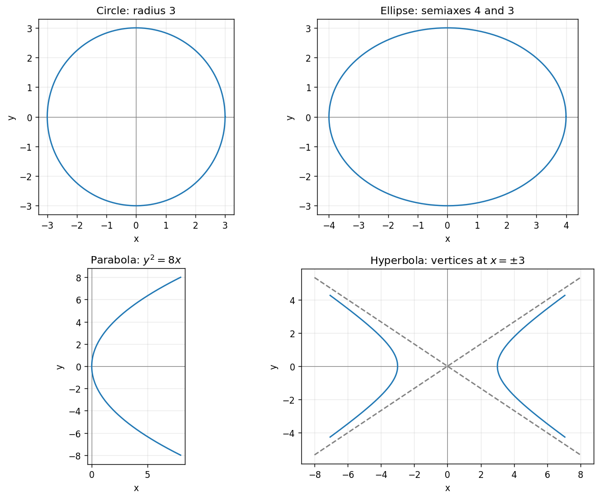

# Exercise 1. Recognizing Curves from Canonical Form

**Circle:** $x^2+y^2=9$ has center $(0,0)$ and radius 3, with intercepts $(\pm3,0)$ and $(0,\pm3)$. Equal positive squared coefficients identify a circle.

**Ellipse:** $x^2/16+y^2/9=1$ has center $(0,0)$, semiaxes 4 along $x$ and 3 along $y$, and intercepts $(\pm4,0),(0,\pm3)$. Both squared terms are positive but have different scales.

**Parabola:** $y^2=8x$ has vertex $(0,0)$, axis $y=0$, and opens right. In $y^2=4px$, $p=2$, giving focus $(2,0)$ and directrix $x=-2$. Only one coordinate is squared.

**Hyperbola:** $x^2/9-y^2/4=1$ has center $(0,0)$, vertices $(\pm3,0)$, asymptotes $y=\pm2x/3$, and foci $(\pm\sqrt{13},0)$. Opposite signs identify a hyperbola with horizontal branches.

