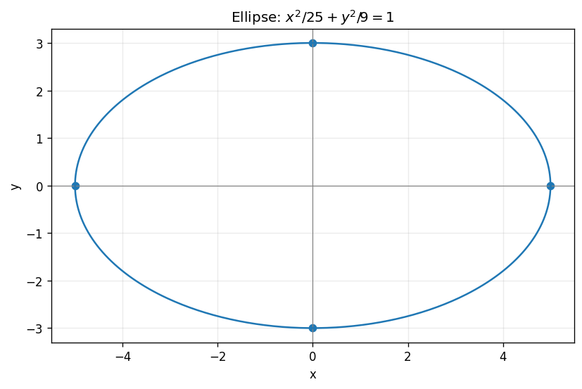

# Exercise 3. Ellipse

The ellipse has center $(0,0)$, horizontal semiaxis 5 and vertical semiaxis 3. Setting $y=0$ gives $x=\pm5$; setting $x=0$ gives $y=\pm3$. It is more stretched along $x$ because the larger denominator $25$ permits a larger maximum magnitude of that coordinate. Each intercept directly satisfies the equation.

