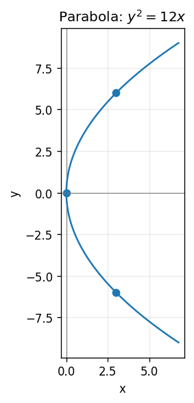

# Exercise 4. Parabola

The vertex is $(0,0)$, the symmetry axis is $y=0$, and the parabola opens toward positive $x$. At $x=3$, $y^2=36$, giving $(3,6)$ and $(3,-6)$. In the form $y^2=4px$ we have $p=3$, so the focus is $(3,0)$ and directrix is $x=-3$. The plotted points and symmetry determine the sketch.

