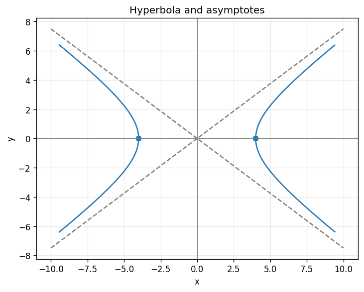

# Exercise 5. Hyperbola and Asymptotes

Setting $y=0$ gives vertices $(\pm4,0)$. There are no $y$-axis intercepts. Dropping the constant from the dominant quadratic terms gives the asymptotes $y=\pm3x/4$.

$$
y=\pm\frac34\sqrt{x^2-16},\qquad |x|\ge4.
$$

For each branch, the appropriate signed difference from an asymptote tends to zero as $|x|\to\infty$, because $|x|-\sqrt{x^2-16}=16/(|x|+\sqrt{x^2-16})\to0$. The branches approach the lines from inside their asymptotic wedges.

