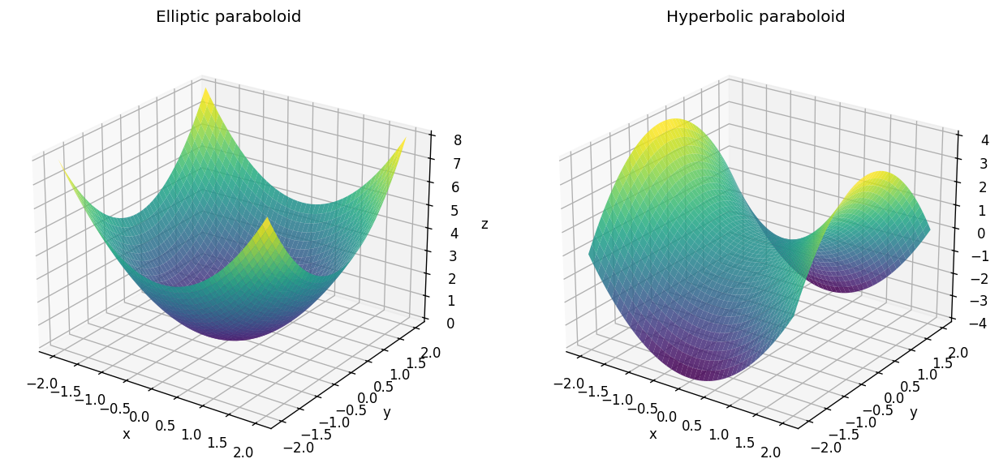

# Exercise 10. Paraboloids

For $z=x^2+y^2$, the sections $x=0$ and $y=0$ are upward parabolas $z=y^2$ and $z=x^2$. Horizontal sections are circles of radius $\sqrt c$ for $c>0$, a point for $c=0$, and empty for $c<0$. This is an elliptic paraboloid, a bowl with vertex at the origin.

For $z=x^2-y^2$, the section $x=0$ is $z=-y^2$ (downward), while $y=0$ is $z=x^2$ (upward). For $c>0$, $x^2-y^2=c$ is a hyperbola opening along $x$; for $c<0$ it opens along $y$; at $c=0$ it is the pair of lines $y=\pm x$. This is a hyperbolic paraboloid, or saddle.

