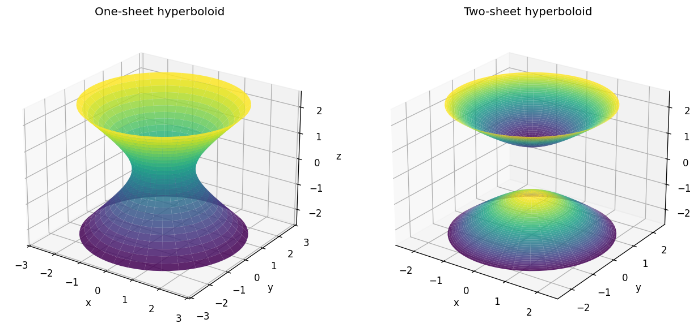

# Exercise 11. Two Similar Surfaces

For $x^2+y^2-z^2=1$, a horizontal section has radius $\sqrt{1+c^2}$ and exists for every $c$. At $c=0,\pm1,\pm2$, the radii are $1,\sqrt2,\sqrt5$. The waist has radius 1, and the surface is connected: a one-sheet hyperboloid.

For $x^2+y^2-z^2=-1$, the radius is $\sqrt{c^2-1}$ when $|c|\ge1$. At $c=0$ there is no section; at $c=\pm1$ there is a point; at $c=\pm2$ the radius is $\sqrt3$. There are two separated components, above $z=1$ and below $z=-1$: a two-sheet hyperboloid.

