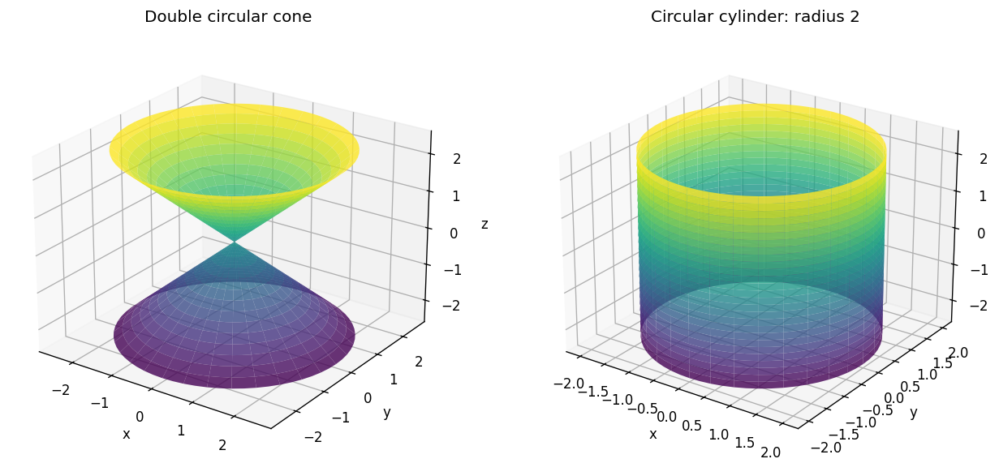

# Exercise 14. Cone and Cylinder

For $x^2+y^2=z^2$, horizontal sections have radius $|c|$, including the point at $c=0$. The section $x=0$ is $y^2=z^2$, the two lines $y=\pm z$; the section $y=0$ is $x=\pm z$. This is a double circular cone with vertex at the origin.

For $x^2+y^2=4$, every horizontal section is a circle of radius 2, independent of $c$. The section $x=0$ is the pair of vertical lines $y=\pm2$; the section $y=0$ is $x=\pm2$. This is a circular cylinder. The cone equation ties the squared radius to $z^2$, while the cylinder equation contains no $z$.

