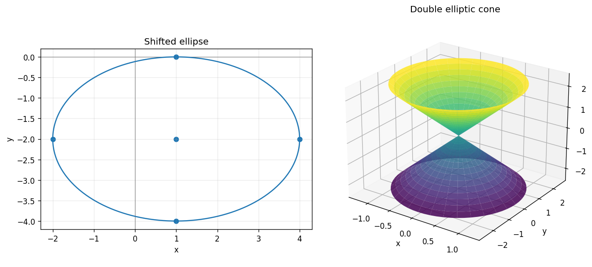

# Exercise 15. Recognition and Sketch Without a Given Name

Complete the squares in the first equation:

$$
4(x-1)^2+9(y+2)^2=36,\qquad \frac{(x-1)^2}{9}+\frac{(y+2)^2}{4}=1.
$$

It is an ellipse centered at $(1,-2)$, with horizontal semiaxis 3 and vertical semiaxis 2. Its horizontal vertices are $(-2,-2),(4,-2)$ and vertical vertices are $(1,-4),(1,0)$. The foci are $(1\pm\sqrt5,-2)$.

For the second equation, horizontal sections at $z=c\ne0$ satisfy $x^2/(c^2/4)+y^2/c^2=1$, with semiaxes $|c|/2$ along $x$ and $|c|$ along $y$. At $c=0$ the section is a point. At $x=0$, $y=\pm z$; at $y=0$, $x=\pm z/2$. These sections identify a double elliptic cone with vertex at the origin, wider along $y$ than along $x$.

