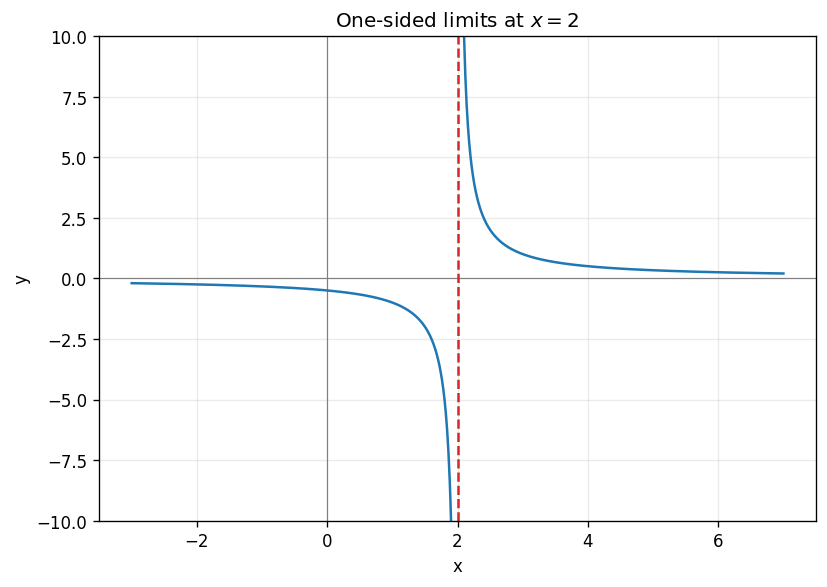

# Exercise 9. One-Sided Limits and an Asymptote

$$
\lim_{x\to2^-}\frac1{x-2}=-\infty,\qquad \lim_{x\to2^+}\frac1{x-2}=+\infty.
$$

The signs follow from the sign of the small denominator. The two-sided limit does not exist, even as a single extended-real value, because the one-sided limits disagree. The vertical asymptote is $x=2$; the left branch falls without bound and the right branch rises without bound. At large $|x|$, both approach $y=0$.

