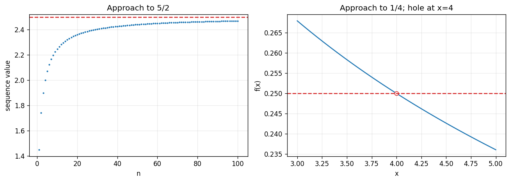

# Exercise 15. Observation Versus Proof

Choose the sequence from Exercise 3 and the function from Exercise 8. The analytical limits are $5/2$ and $1/4$, proved there by rationalization.

| $n$ | $\sqrt{n^2+5n}-n$ |
| --- | --- |
| 10 | 2.247449 |
| 100 | 2.469508 |
| 1000 | 2.496883 |
| 10000 | 2.499688 |

| $x<4$ | $f(x)$ | $x>4$ | $f(x)$ |
| --- | --- | --- | --- |
| 3.9 | 0.251582 | 4.1 | 0.248457 |
| 3.99 | 0.250156 | 4.01 | 0.249844 |
| 3.999 | 0.250016 | 4.001 | 0.249984 |

The sequence approaches $2.5$ from below, while the function approaches $0.25$ from above on the left and below on the right. Finite samples cannot exclude later outliers or oscillations between sampled arguments; the algebraic limit arguments control all sufficiently close arguments.

