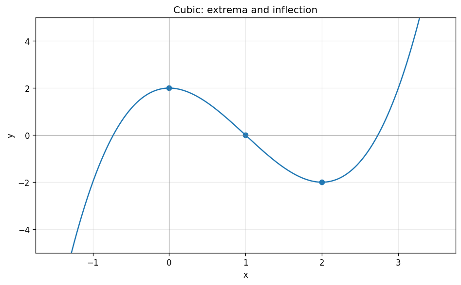

# Exercise 1. A Cubic Polynomial

The domain is $\mathbb R$. Differentiate:

$$
f\prime(x)=3x(x-2).
$$

The derivative is positive for $x<0$, negative for $0<x<2$, and positive for $x>2$. Thus $f$ increases on $(-\infty,0)$, decreases on $(0,2)$, and increases on $(2,\infty)$. The local maximum is $(0,2)$ and local minimum is $(2,-2)$. Neither is global, since the end limits are $-\infty$ and $+\infty$. For the sketch, $f\prime\prime(x)=6x-6$ gives inflection $(1,0)$, and factoring gives zeros $1-\sqrt3,1,1+\sqrt3$.

