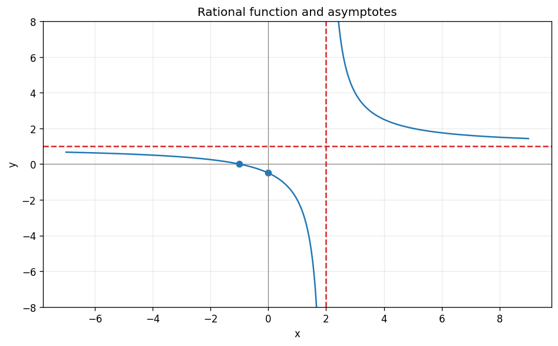

# Exercise 3. A Rational Function

$$
f(x)=1+\frac3{x-2},\qquad f\prime(x)=-\frac3{(x-2)^2}<0.
$$

The domain is $\mathbb R\setminus\{2\}$ and the zero is $x=-1$. The vertical asymptote is $x=2$, with left limit $-\infty$ and right limit $+\infty$. The horizontal asymptote is $y=1$ at both ends of the real line. The function decreases on each of $(-\infty,2)$ and $(2,\infty)$ and has no extrema. It passes through $(0,-1/2)$; its left branch is below $y=1$ and its right branch above it.

