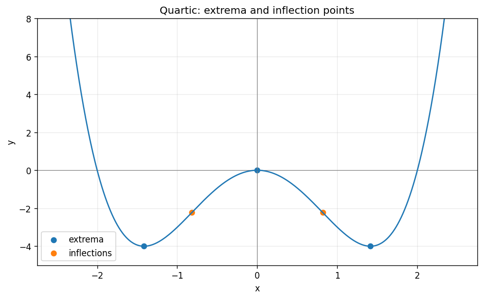

# Exercise 8. The Second Derivative

$$
f\prime(x)=4x(x^2-2),\qquad f\prime\prime(x)=12x^2-8.
$$

The first derivative signs, from left to right across $-\sqrt2,0,\sqrt2$, are $-,+,-,+$. Therefore the local (also global) minima are $(\pm\sqrt2,-4)$ and the local maximum is $(0,0)$. The graph is convex (concave up) on $(-\infty,-\sqrt{2/3})$ and $(\sqrt{2/3},\infty)$, and concave down on $(-\sqrt{2/3},\sqrt{2/3})$. Inflection points are $(\pm\sqrt{2/3},-20/9)$, because the second derivative changes sign there. The function is even, has zeros $-2,0,2$, and tends to $+\infty$ at both ends.

