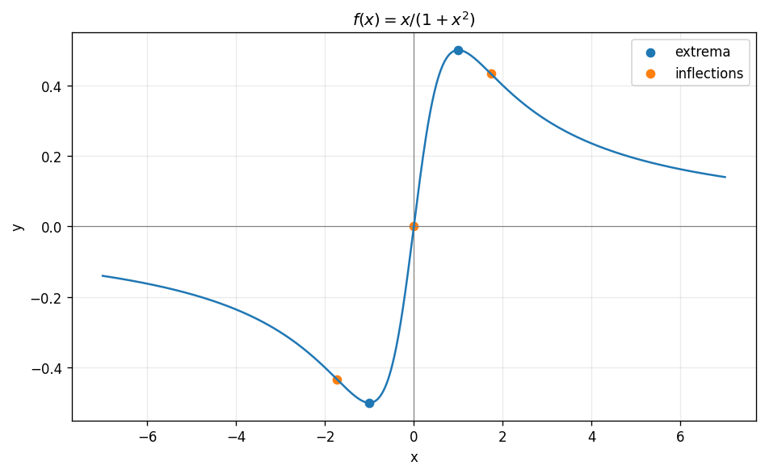

# Exercise 10. Complete Function Analysis

The domain is $\mathbb R$; the function is odd, with only zero $(0,0)$. At $-\infty$ and $+\infty$, it tends to $0^-$ and $0^+$ respectively, so $y=0$ is a horizontal asymptote and there are no vertical asymptotes.

$$
f\prime(x)=\frac{1-x^2}{(1+x^2)^2},\qquad f\prime\prime(x)=\frac{2x(x^2-3)}{(1+x^2)^3}.
$$

It decreases on $(-\infty,-1)$, increases on $(-1,1)$, and decreases on $(1,\infty)$. The global minimum is $(-1,-1/2)$ and global maximum is $(1,1/2)$, giving range $[-1/2,1/2]$.

The second derivative is negative on $(-\infty,-\sqrt3)$, positive on $(-\sqrt3,0)$, negative on $(0,\sqrt3)$, and positive on $(\sqrt3,\infty)$. These are respectively concave-down, convex, concave-down, and convex intervals. The inflection points are $(-\sqrt3,-\sqrt3/4)$, $(0,0)$, and $(\sqrt3,\sqrt3/4)$.

