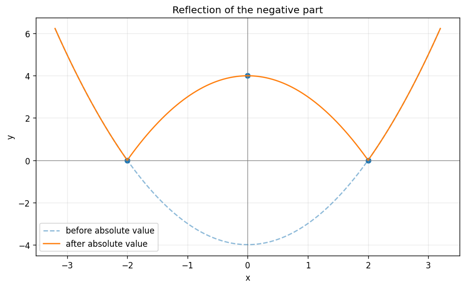

# Exercise 12. A Function with an Absolute Value

The absolute value leaves the parts of $y=x^2-4$ above the horizontal axis unchanged and reflects the parts below it upward. Thus $f=x^2-4$ for $|x|\ge2$ and $f=4-x^2$ for $|x|<2$.

The domain is $\mathbb R$, the function is even and continuous, and the zeros $(\pm2,0)$ are global minima. It decreases on $(-\infty,-2)$, increases on $(-2,0)$, decreases on $(0,2)$, and increases on $(2,\infty)$, with local maximum $(0,4)$. At $x=-2$, the left and right derivatives are $-4$ and $4$; at $x=2$ they are $-4$ and $4$. Both are corners where the derivative does not exist. Away from those corners, the graph is convex outside $[-2,2]$ and concave down inside.

