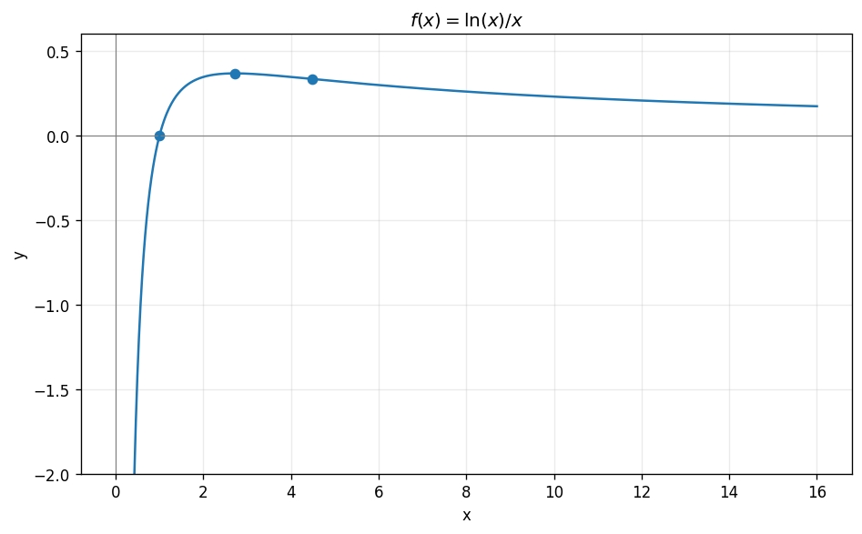

# Exercise 13. A Logarithm and an Asymptote

The domain is $(0,\infty)$ and the only zero is $x=1$. The function is negative for $0<x<1$ and positive for $x>1$.

$$
f\prime(x)=\frac{1-\ln x}{x^2},\qquad f\prime\prime(x)=\frac{2\ln x-3}{x^3}.
$$

It increases on $(0,e)$ and decreases on $(e,\infty)$, with global maximum $(e,1/e)$. It is concave down on $(0,e^{3/2})$ and convex on $(e^{3/2},\infty)$, with inflection $(e^{3/2},3/(2e^{3/2}))$.

As $x\to0^+$, $\ln x/x\to-\infty$, so $x=0$ is a vertical asymptote. As $x\to\infty$, the limit is $0^+$, giving horizontal asymptote $y=0$. Domain, end behavior, the zero, maximum, and curvature determine the sketch; the right branch must approach zero from above.

