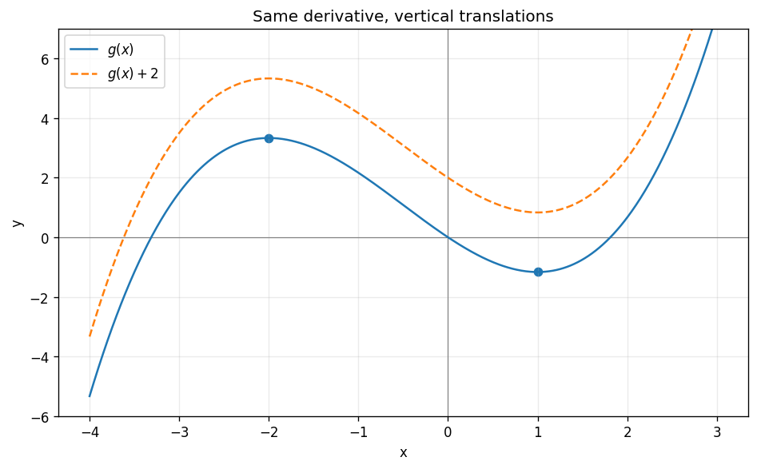

# Exercise 14. Reconstructing Information from the Derivative

The derivative $(x-1)(x+2)$ is positive on $(-\infty,-2)$, negative on $(-2,1)$, and positive on $(1,\infty)$. Thus every such function increases, then decreases, then increases, with a local maximum at $x=-2$ and local minimum at $x=1$.

$$
g\prime(x)=x^2+x-2=(x-1)(x+2).
$$

The specific values are $g(-2)=10/3$ and $g(1)=-7/6$. Any function with this derivative on $\mathbb R$ is $g+C$, so the earlier qualitative sketch determines the shape but leaves its vertical translation unspecified.

