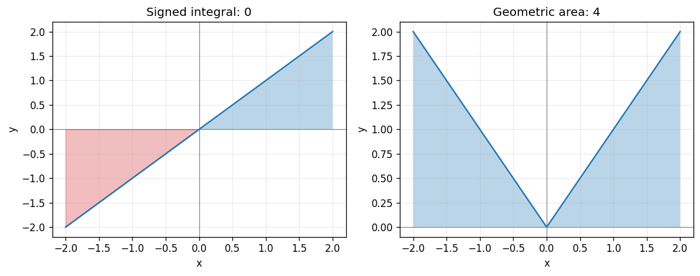

# Exercise 12. Symmetry, Sign, and Absolute Value

The odd function $x$ has canceling signed contributions on a symmetric interval, so its integral should be zero. The even nonnegative function $|x|$ gives two equal triangular areas, so its integral should be positive.

$$
\int_{-2}^{2}x\,dx=\left[\frac{x^2}{2}\right]_{-2}^{2}=0.
$$

$$
\int_{-2}^{2}|x|\,dx=2\int_0^2x\,dx=4.
$$

The first measures signed accumulation; the second measures the total geometric area.

