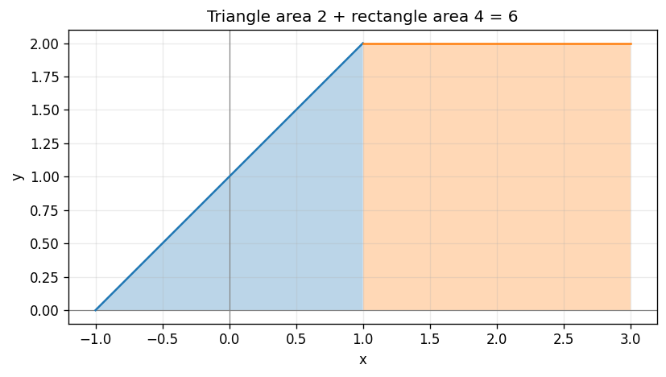

# Exercise 14. A Piecewise-Defined Function

The graph rises linearly from $(-1,0)$ to $(1,2)$, then stays horizontal at height 2 until $x=3$. The definition changes at 1, so split there:

$$
\int_{-1}^{3}f(x)\,dx=\int_{-1}^{1}(x+1)\,dx+\int_1^3 2\,dx=2+4=6.
$$

Geometrically, the first region is a triangle of base 2 and height 2, area 2; the second is a rectangle of width 2 and height 2, area 4. Their total is 6. The value at the single split point does not change the integral.

