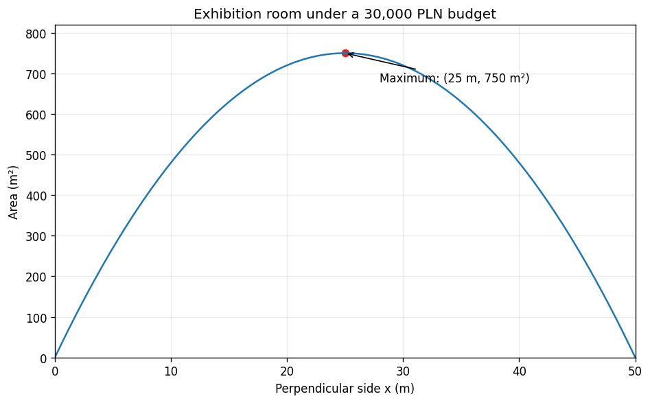

# Exercise 12. Complete Model and Computer Verification

Let $x$ be the length in meters of each side perpendicular to the existing wall, and $y$ the length in meters parallel to it. For a positive-area optimum the entire budget is used, because any unused budget could enlarge a side. Thus the modeling step gives

$$
2(300)x+500y=30000,\qquad y=60-\frac65x.
$$

The area model and physical domain are

$$
A(x)=xy=60x-\frac65x^2,\qquad 0<x<50.
$$

The calculus step gives

$$
A\prime(x)=60-\frac{12}{5}x,\qquad A\prime(x)=0\Longleftrightarrow x=25,\qquad A\prime\prime(x)=-\frac{12}{5}<0.
$$

The unique global maximum is at $x=25$ m and $y=30$ m, with area $750\,\mathrm m^2$. The cost is $600(25)+500(30)=30000$ PLN. Equivalently,

$$
A(x)=750-\frac65(x-25)^2\le750.
$$

The zero-area limiting endpoints confirm that no boundary improves it.

After this mathematical solution, computer evaluation gives:

| $x$ (m) | $y$ (m) | Area ($\mathrm m^2$) |
| --- | --- | --- |
| 24 | 31.2 | 748.8 |
| 24.5 | 30.6 | 749.7 |
| 25 | 30 | 750 |
| 25.5 | 29.4 | 749.7 |
| 26 | 28.8 | 748.8 |

The plotted parabola and numerical values verify the optimum; the proof is the derivative sign or completed-square identity. Choosing variables, cost weights, the budget equality, and the physical domain required modeling. Differentiation, solving the stationary equation, and evaluating the model were subsequent calculations.

